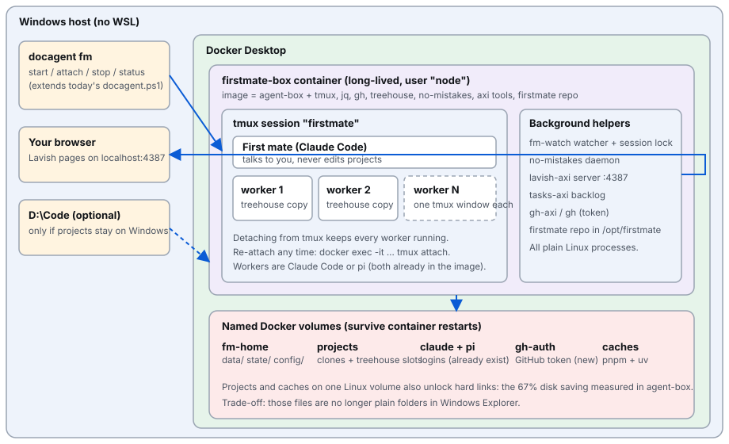

# firstmate-in-a-box

Run [firstmate](https://github.com/Charikshith/firstmate) inside one long-lived Linux Docker container on Windows, with no WSL, using the agent-box launcher.

- **firstmate** is a supervisor for a crew of coding agents: a "first mate" talks to you and hands tasks to worker agents.
- **agent-box** is a Docker launcher for Claude Code and pi on Windows. `docagent cc` and `docagent pi` start one agent in a throwaway container.

This repo holds the plan, the architecture diagram, and the code that adds firstmate to agent-box. It does not contain a firstmate fork, any login, or any personal data.

## Why

Firstmate is built for Linux. Its Windows port is the part that keeps breaking (locks, process lookup). A Linux container is the platform firstmate was written for. So the plan is one Linux image with agent-box's tools plus firstmate's tools, running the first mate and every worker as tmux windows in a single container that stays up.

## Architecture



- The Windows host runs Docker Desktop. You type `docagent fm ...` in PowerShell; everything after that runs in Linux.
- One container, `firstmate-box`, is detached and restarts with `--restart unless-stopped`. It runs as user `node`.
- Inside it, tmux session `firstmate` has one window for the first mate (Claude Code) and one window per worker.
- Background helpers are plain Linux processes: the firstmate watcher, the no-mistakes daemon, the lavish-axi server (port 4387, published on `127.0.0.1` only), and the `gh` / `*-axi` tools. Firstmate itself is cloned into `/opt/firstmate` at a pinned commit.
- Everything that must survive lives in named Docker volumes: `fm-home` (firstmate's data, state, config, git identity, worktree pool, no-mistakes database), `fm-projects` (project clones), `fm-gh` (GitHub token), `agent-box-claude` and `agent-box-pi` (logins), `agent-box-pnpm` and `agent-box-uv` (package caches).
- Projects live in a volume, not on `D:\Code`. The cost: you cannot open those files directly from Windows tools.

The full plan page, with options compared and risks, is [docs/plan.html](docs/plan.html). Open it in a browser; it follows your light or dark setting. Note it was written before the build, so it still says "nothing here has been built yet"; [docs/DECISIONS.md](docs/DECISIONS.md) records what was actually built and checked.

## The base image

`Dockerfile.firstmate` starts with `FROM agent-box`. The base image's Dockerfile is `Dockerfile.base` in this repo; build it first and tag it `agent-box`.

What the base image contains:

- Node 22 on Debian bookworm-slim
- a non-root user `node` (uid 1000)
- git, python3
- pnpm, uv
- Claude Code and pi

`Dockerfile.firstmate` assumes the home directory `/home/node`, and that `claude` and `pi` are on the `PATH`.

## Phased plan

| Phase | What | Who | What you should see when it works |
|---|---|---|---|
| 0 | Decide two things: projects in a Docker volume or on `D:\Code`; how the container reaches GitHub (fine-grained token in a volume). | You | You pick the options. This repo assumes volume + token. |
| 1 | **Image.** `Dockerfile.firstmate` adds tmux, jq, procps, bash, unzip, `gh`, treehouse, no-mistakes, five `*-axi` tools and the firstmate checkout to `agent-box`. All versions pinned. | A worker | `docker build` finishes; `tmux -V`, `gh --version`, `treehouse --version` print versions inside the box. |
| 2 | **Long-lived container.** `docagent fm start/attach/stop/status/rm`. | A worker, then you check | Close the terminal, run `docagent fm attach`, and you are back in the same session with workers still running. |
| 3 | **First-run bootstrap.** `fm-box-init` writes config, checks tools, and lists the logins still to do. You do the logins by hand. | You, about 10 minutes, once | `docker exec firstmate-box fm-box-init` lists only the steps still open; later restarts never ask again. |
| 4 | **Bring old state across.** `scripts/fm-box-import-data.ps1` copies firstmate's `data\` folder into the box. `state\` is left behind on purpose. | You, with a check of the result | Your backlog, preferences and project list show up in the first session in the box. |
| 5 | **Prove it with a small task:** lock acquired with no read-only banner; spawn a scout and see its tmux window, detach, re-attach; stop and start and see the first mate recover from disk; open a lavish page in a Windows browser; ship one small issue end to end to a PR URL. | You or a worker, reporting each result including failures | All five checks pass, ending with a real PR link made from inside the box. If one fails, the Windows setup is untouched. |
| 6 | **Polish:** auto-start after a reboot, status command, optional network allowlist. | A worker, later | The box starts after a reboot without you; `docagent fm status` says what is running. |

Phases 1 to 4 have code here. Phases 5 and 6 are not done (see below).

## Build, start, attach, stop, check, remove

You need Docker Desktop on Windows and PowerShell. Put `bin` on your `PATH` so `docagent` resolves (a `docagent.cmd` shim is not included; call `bin\docagent.ps1` or add your own).

```powershell
# 1. base image (from this repo root)
docker build -f Dockerfile.base -t agent-box .
# 2. firstmate image (from this repo's root)
docker build -f Dockerfile.firstmate -t agent-box-fm .

docagent fm start     # create and start the box (idempotent)
docagent fm attach    # open the first mate; Ctrl-b d detaches and leaves it running
docagent fm status    # running / stopped / not created, plus tmux windows
docagent fm stop      # pause everything, keep all data
docagent fm rm        # remove the stopped container (volumes are kept)
```

`docagent fm start` runs `fm-box-init` after creating the box. It prints the steps left by hand: GitHub login (`gh auth login` with a fine-grained token), git identity, Claude login, and a one-time bypass-permissions prompt. It never logs in for you. Details: [docs/FIRSTMATE-IN-BOX.md](docs/FIRSTMATE-IN-BOX.md).

Environment variables: `FM_BOX_PORT` (host port, default 4387), `FM_BOX_SUFFIX` (appended to the container and every volume name, for tests), `AGENT_BOX_FM_IMAGE` (default `agent-box-fm`), `AGENT_BOX_ROOT` (default `D:\Code`, used by `docagent cc|pi`).

## Stop semantics

- **Closing the terminal keeps the box running.** It is a detached container.
- **`docagent fm stop` pauses everything and keeps data.** The first mate, workers and tmux end; the container filesystem and all volumes stay. `docagent fm start` brings it back and the first mate recovers from `FM_HOME` on disk. Work in flight at the moment of the stop may be cut off.
- **An explicitly stopped box stays stopped.** With `--restart unless-stopped`, a Docker or machine restart brings back a running box but not one you stopped.
- Docker Desktop itself must be running; enable "Start Docker Desktop when you sign in" if you want the box back after a reboot.
- **Erasing volumes is permanent.** `docagent fm rm` never removes a volume. `docker volume rm` on the `fm-*` volumes deletes state, clones and logins for good. Only do it on purpose.

## Files

| Path | What |
|---|---|
| `Dockerfile.base` | The `agent-box` base image |
| `Dockerfile.firstmate` | Adds firstmate's tools to `agent-box` |
| `bin/docagent.ps1` | The launcher (`cc`, `pi`, and the `fm` subcommands) |
| `scripts/fm-box-entry.sh` | PID 1 of the box: starts the first mate in tmux |
| `scripts/fm-box-init.sh` | First-run bootstrap and tool check |
| `scripts/fm-box-import-data.ps1` | Copies old firstmate `data\` into the box |
| `.gitattributes` | Keeps shell scripts and Dockerfiles LF |
| `docs/FIRSTMATE-IN-BOX.md` | How the box works, commands, hand steps |
| `docs/DECISIONS.md` | Design decisions, what was checked and what was not |
| `docs/plan.html`, `docs/architecture.svg` | The plan page and the diagram |

## Snapshot source

The code and the two docs are a verbatim snapshot of the agent-box branch `fm/agent-box-fm-image` at commit `29a7453bfbcc702f19c612567a99e1407717c8d1`. Two small edits were made for publication: `docs/DECISIONS.md` keeps only the firstmate section, and one line in `docs/FIRSTMATE-IN-BOX.md` that named a private project was reworded. `docs/plan.html` drops its review-tool comment forms and a few private project names; `docs/architecture.svg` is the plan's figure with fixed colors.

`Dockerfile.firstmate` pins the firstmate checkout to a commit of the author's firstmate fork (`Charikshith/firstmate`). Change `FIRSTMATE_REPO` and `FIRSTMATE_COMMIT` to use another.

## Not yet verified

- Real logins (GitHub, Claude, the bypass prompt). These need a human and were not tried.
- A real end-to-end firstmate task in the box: an authenticated first-mate session, workers as tmux windows, treehouse and no-mistakes doing real work, firstmate reconciling after a stop and start.
- Importing real firstmate data, and whether its briefs (which contain Windows paths) are useful inside the box.
- Behaviour after a real Windows reboot. Only a Docker Desktop restart was tried.
- Browser tooling (no Chromium in the image), arm64 (amd64 only), a network allowlist.

What was checked (2026-10-13, Docker Desktop 29.8.2): the image builds and its tools run as `node`; `fm start`, `status`, `attach`, `stop` and `rm` work and are idempotent; a box started from a killed PowerShell window kept running; after a Docker Desktop restart the running box came back and the stopped box stayed stopped; the import script's `-WhatIf` and refusal paths work. See [docs/DECISIONS.md](docs/DECISIONS.md).

## License

This project is MIT licensed; see [LICENSE](LICENSE).
